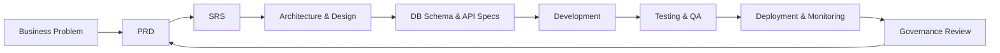

# Ask My CCTV Documentation Set

This directory is the engineering source of truth for **Ask My CCTV: AI-Powered Natural Language CCTV Video Search and Event Detection System**.

## Document Control

| Field | Value |
|---|---|
| Owner | Ask My CCTV Engineering & Architecture Team |
| Version | 2.0.0 (Enterprise Industry Specification) |
| Status | Approved Baseline Specification |
| Review Cadence | At every milestone phase gate and release |

---

## Documentation Lifecycle

---

## Document Index & Sequence

0. [Consolidated Master Engineering Blueprint](ask-my-cctv-detailed-document.md)
1. [Business Problem Specification](01-business-problem.md)
2. [Product Requirements Document (PRD)](02-prd.md)
3. [Software Requirements Specification (SRS - ISO/IEC/IEEE 29148)](03-srs.md)
4. [Use Cases Specification](04-use-cases.md)
5. [Functional Requirements](05-functional-requirements.md)
6. [Non-Functional Requirements & Performance SLAs](06-non-functional-requirements.md)
7. [System Architecture Blueprint (C4 Model)](07-system-architecture.md)
8. [Detailed Technical Design](08-detailed-design.md)
9. [Enterprise Database & Vector Index Schema](09-database-design.md)
10. [OpenAPI 3.0 REST & WebSocket API Specification](10-api-specification.md)
11. [AI/ML & Natural Language Vector Architecture](11-ai-ml-design.md)
12. [Security, Privacy & Evidence Compliance](12-security-privacy-design.md)
13. [Development Plan & Workflow Guidelines](13-development.md)
14. [Testing & Quality Assurance Strategy](14-testing.md)
15. [Deployment & Infrastructure Blueprint](15-deployment.md)
16. [Monitoring & Observability Specification](16-monitoring.md)
17. [Documentation Governance](17-documentation.md)

---

## Governance & Change Control

All updates to system behavior, API contracts, or AI model specifications MUST update the corresponding document in this directory prior to or alongside code PR submission.
