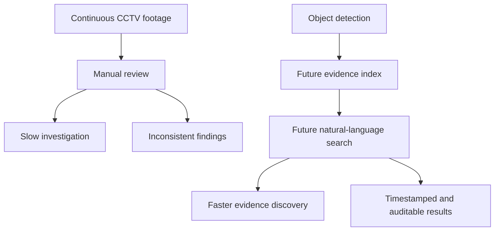

# Business Problem

## Problem statement

CCTV footage is recorded continuously, but reviewing it manually is slow, inconsistent, and difficult when an operator needs to find a specific vehicle, person, or event.

## Proposed solution

Ask My CCTV will process CCTV footage, detect objects and events, index video evidence, and allow authorized users to search footage using natural language.

## Users

- Security operators reviewing incidents
- Supervisors investigating activity
- System administrators managing cameras, users, and retention
- Investigators exporting evidence

## Business outcomes

- Reduce time required to locate relevant footage
- Improve consistency of incident review
- Preserve evidence links and timestamps
- Support scalable processing of multiple cameras

## Phase 1 boundary

The first deliverable is offline video processing and annotated object detection. It does not provide search, tracking, event detection, APIs, or a dashboard.

## Problem-to-value chain


```
Example scenario:
A society has Gate 1 and Gate 2. The Gate 1 watchman goes to the washroom. During that time, a suspicious person enters from Gate 1. The system detects unusual activity, tracks the person live, understands that no guard is present, and automatically alerts or calls the Gate 2 guard. The AI agent explains live: “A suspicious person entered Gate 1 at 10:42. Please check the east side camera now.”
Your current project is close in design, but not real enough yet.
Main Features You Actually Need
1. Video Upload + Conversation With Video
   User uploads CCTV video.
   System processes it.
   User asks:
   - “Who entered the gate after 9 PM?”
   - “Show person wearing black shirt.”
   - “Track this person.”
   - “What happened when guard was absent?”
2. Accurate Video Search
   This needs better indexing:
   - object detection: person, car, bike, bag
   - tracking IDs
   - timestamps
   - visual descriptions
   - event labels
   - embeddings/vector search
3. Live Video Tracking
   Connect live CCTV/RTSP camera.
   Detect and track people in real time.
   Maintain object identity:
   - Person #1 entered Gate 1
   - Person #1 moved to parking
   - Person #1 seen near Gate 2
4. Multi-Camera Tracking
   This is the hard part.
   You need ReID, meaning the system recognizes the same person/object across different cameras.
5. Suspicious Activity Detection
   Rules like:
   - guard absent from gate
   - person enters restricted area
   - loitering
   - running
   - entering at night
   - object left behind
   - crowd/fight detection
6. AI Calling Agent
   When event is serious:
   - call Gate 2 guard
   - speak the incident summary
   - share camera/video clip
   - allow live conversation
   - log the call
This can be done using services like Twilio, WhatsApp Business API, or a phone/SIP calling system.
What Is Wrong In Current Project
Your current project has:
- upload video support
- YOLO detection foundation
- search API
- frontend UI
But it still has problems:
- search is not accurate enough
- live CCTV tracking is not implemented
- multi-camera tracking is partly simulated
- calling agent is fake UI, not real call
- evidence export is hardcoded
- frontend hides backend failure sometimes
Best Development Plan
First fix the core. Do not start with calling agent first.
1. Phase 1: Make uploaded video search perfect
   Upload video, process with YOLO, save detections/tracks/events, search from real DB.
2. Phase 2: Add natural-language video Q&A
   Convert user question into filters:
   “black shirt person at gate” → person + color + location + time.
3. Phase 3: Add live CCTV stream
   Use RTSP/webcam stream.
   Run detection every frame or every N frames.
   Show live tracked objects on frontend.
4. Phase 4: Add multi-camera ReID
   Same person across Gate 1 and Gate 2.
5. Phase 5: Add suspicious-event engine
   Example:
   guard_absent AND unknown_person_enters_gate => high alert
6. Phase 6: Add real AI calling agent
   Use Twilio/SIP.
   AI speaks incident summary to Gate 2 guard.
The immediate next technical goal should be:
```
