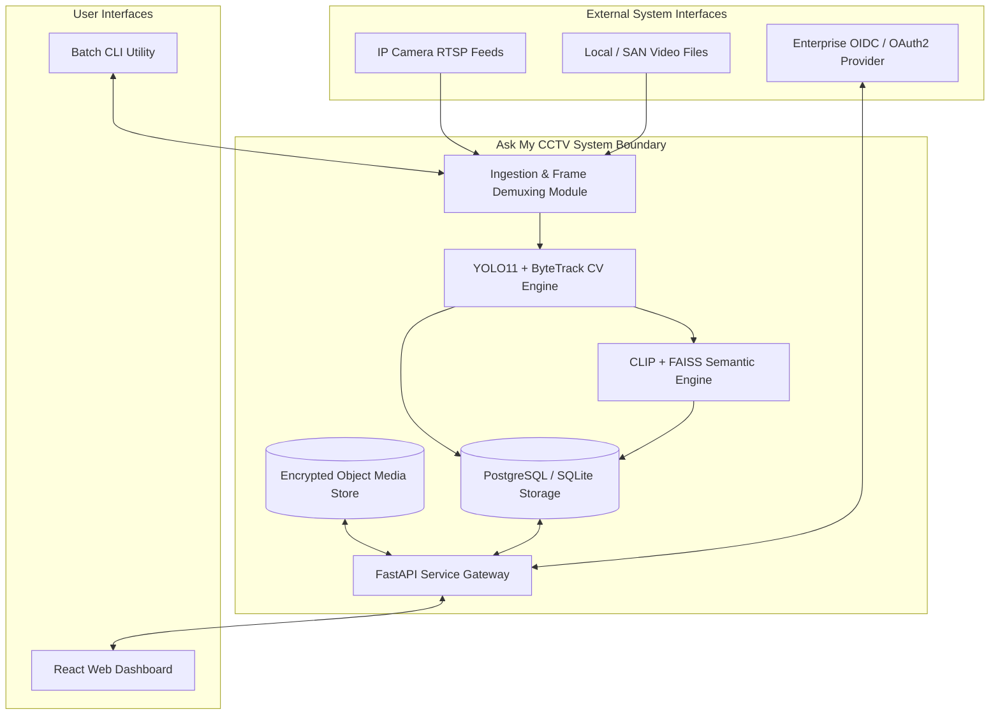

# Software Requirements Specification (SRS)

| Field | Value |
|---|---|
| Project | Ask My CCTV |
| Document Version | 2.0.0 (ISO/IEC/IEEE 29148 Compliant Standard) |
| System Classification | Distributed Computer Vision & Natural Language Video Analytics Platform |
| Status | Approved Baseline Specification |

---

## 1. Introduction

### 1.1 Purpose
This Software Requirements Specification (SRS) establishes the formal functional, non-functional, interface, and operational requirements for the **Ask My CCTV** system. It serves as the binding reference for software developers, AI engineers, test automation engineers, and system architects.

### 1.2 System Overview
The system processes continuous or batch CCTV video feeds using deep learning object detection (YOLO11), multi-object tracking (ByteTrack), multimodal vector embedding (CLIP), vector similarity indexing (FAISS), and natural language query interpretation.

---

## 2. Overall Description

### 2.1 System Context & Boundary

### 2.2 User Class Characteristics
* **Security Operators**: Require simple, rapid query interfaces, low latency alert popups, and high visual clarity.
* **Forensic Investigators**: Require detailed query builders, exact frame-level timestamp correlation, trajectory mapping, and high-fidelity video clip exports.
* **System Administrators**: Require full API metrics, worker health endpoints, stream registration configs, and audit logs.

---

## 3. Specific Functional Requirements

### 3.1 Video Ingestion & Processing Module (`REQ-INGEST`)
* **`REQ-INGEST-01`**: The system **MUST** support decoding video streams from local storage (`.mp4`, `.avi`, `.mkv`) and live network RTSP protocols (`rtsp://`).
* **`REQ-INGEST-02`**: Frame demuxing **MUST** maintain accurate source timestamps and frame sequence numbers without frame drop or drift.
* **`REQ-INGEST-03`**: Ingestion workers **MUST** handle network disconnection gracefully by attempting automatic RTSP re-connection with exponential backoff (initial interval: 2s, max interval: 60s).

### 3.2 Computer Vision & Tracking Engine (`REQ-CV`)
* **`REQ-CV-01`**: The system **MUST** perform object detection utilizing Ultralytics YOLO11, extracting bounding boxes $(x_1, y_1, x_2, y_2)$, target class, and confidence score $C \in [0.0, 1.0]$.
* **`REQ-CV-02`**: The CV engine **MUST** filter detections against configurable confidence thresholds (default: $0.50$).
* **`REQ-CV-03`**: The system **MUST** maintain object identities across consecutive frames using ByteTrack, assigning a unique persistent `track_id` to each entity.

### 3.3 Semantic Search & Natural Language Query Engine (`REQ-SEARCH`)
* **`REQ-SEARCH-01`**: The system **MUST** extract 512-dimensional vector embeddings for detected object snippets using CLIP (`ViT-B/32`).
* **`REQ-SEARCH-02`**: Vector embeddings **MUST** be indexed into a FAISS index to support cosine similarity / L2 distance vector queries.
* **`REQ-SEARCH-03`**: The system **MUST** parse natural language prompts (e.g. *"Red truck moving left to right"*) into combined SQL filters (time, camera, class) and FAISS vector search operations.

### 3.4 Storage & Data Management (`REQ-DATA`)
* **`REQ-DATA-01`**: Metadata and event records **MUST** be persisted in SQLite (Phase 1 local) or PostgreSQL (Phase 4 enterprise).
* **`REQ-DATA-02`**: Annotated video outputs **MUST** be written to temporary isolated files (`.part.mp4`) and published atomically to target destinations only upon complete execution.

---

## 4. System Interface Requirements

### 4.1 Software Interfaces
* **OpenCV**: Version $\ge 4.8.0$ for frame decoding, image transformation, and MP4 container encoding.
* **PyTorch / TensorRT**: CUDA-accelerated execution environment for YOLO11 and CLIP inference.
* **FastAPI**: Asynchronous Python framework providing REST OpenAPI specifications and WebSocket endpoints.
* **React**: Modern SPA web framework using HTML5 Canvas for real-time video overlay rendering.

### 4.2 Hardware & Acceleration Constraints
* **Minimum Host Specifications**: 4 vCPUs, 8 GB System RAM, 20 GB available NVMe storage.
* **Recommended Hardware**: NVIDIA GPU with $\ge 8$ GB VRAM (CUDA Compute Capability $\ge 7.5$, TensorRT support enabled).

---

## 5. Non-Functional Requirements & Design Constraints

### 5.1 Performance & Scalability
* **`NFR-PERF-01`**: GPU batch processing throughput **MUST** reach $\ge 60$ FPS for 1080p input video feeds.
* **`NFR-PERF-02`**: The search engine **MUST** return top-20 ranked clip matches within $500$ ms for datasets containing up to $1,000,000$ indexed frame detections.

### 5.2 Security & Integrity
* **`NFR-SEC-01`**: All stored video clips **MUST** compute and record a SHA-256 digital fingerprint to guarantee non-repudiation.
* **`NFR-SEC-02`**: API communications **MUST** enforce TLS 1.3 encryption and OAuth2/JWT token authentication.

### 5.3 Reliability & Availability
* **`NFR-REL-01`**: The service **MUST** achieve $99.9\%$ runtime availability with zero loss of raw incoming video feed data.
* **`NFR-REL-02`**: System crashes during processing **MUST** automatically release file locks and clean uncommitted temporary `.part` artifacts.
