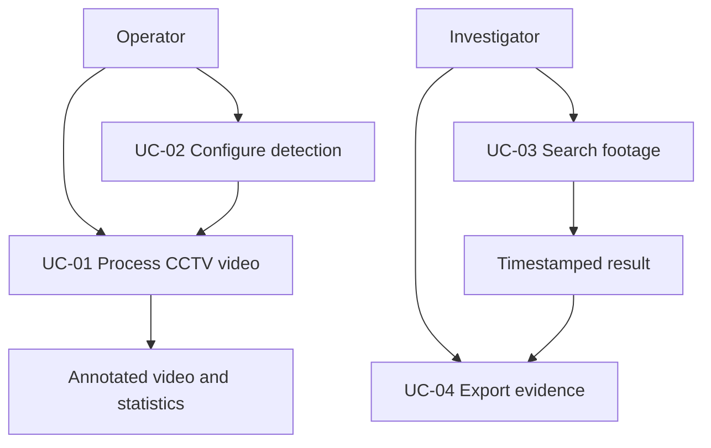

# Use Cases

Use-case IDs are stable references for requirements and tests. "Future" use cases are design targets, not implemented behavior.

## UC-01 Process CCTV video

**Actor:** Operator

**Preconditions:** model exists; input is readable; output directory is writable.

1. Operator places a video in the configured input location.
2. Operator starts the detector.
3. System validates configuration, model, and input video.
4. System reads frames and runs YOLO11 inference for configured road-vehicle classes.
5. System writes annotations to a temporary output video.
6. System reports progress and summary statistics.
7. System publishes the output only after successful completion.

**Alternative:** If input, model, capture, or writer initialization fails, the system stops with a clear error.

**Postconditions:** successful run has a playable final output; failed run has no newly published final output.

## UC-02 Configure detection

**Actor:** Operator

1. Operator supplies model, input, output, or confidence arguments.
2. System validates the confidence range.
3. System processes using the supplied configuration.

**Validation:** confidence MUST be between 0.0 and 1.0.

## UC-03 Search footage (future)

**Actor:** Investigator

1. Investigator submits a natural-language question.
2. System interprets entities, time, location, and event constraints.
3. System retrieves matching indexed evidence.
4. System returns timestamps, clips, confidence, and source video.

## UC-04 Export evidence (future)

An authorized investigator selects a result and exports a bounded clip with metadata and audit information.

## Traceability

UC-01 maps to FR-001 through FR-007. UC-02 maps to FR-008. UC-03 and UC-04 map to future FR-011 through FR-014.

## Use-case relationship

