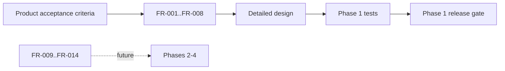

# Functional Requirements

Priority values: **P0** is required for the Phase 1 acceptance gate, **P1** is planned, and **P2** is exploratory.

| ID | Requirement | Priority | Phase | Acceptance evidence |
|---|---|---:|---:|---|
| FR-001 | Load the configured YOLO11 checkpoint and fail clearly if it cannot load | P0 | 1 | Startup/error test |
| FR-002 | Validate that the input video exists and is readable | P0 | 1 | Missing/invalid input test |
| FR-003 | Read frames sequentially with OpenCV | P0 | 1 | Frame count comparison |
| FR-004 | Detect configured road-vehicle classes per frame | P0 | 1 | Annotated fixture |
| FR-005 | Render bounding boxes, class names, and confidence scores | P0 | 1 | Output inspection |
| FR-006 | Write a playable annotated video without publishing partial output | P0 | 1 | Codec/output integrity test |
| FR-007 | Print frame and per-class detection statistics | P0 | 1 | CLI output assertion |
| FR-008 | Configure model, input, output, and confidence from CLI | P0 | 1 | CLI test |
| FR-009 | Track object identity across frames | P1 | 2 | Tracker evaluation |
| FR-010 | Detect higher-level temporal events | P1 | 3 | Event test set |
| FR-011 | Index evidence for semantic retrieval | P1 | 3 | Retrieval benchmark |
| FR-012 | Accept natural-language queries | P1 | 4 | Query acceptance tests |
| FR-013 | Return timestamped evidence and clips | P1 | 4 | API integration test |
| FR-014 | Manage users, permissions, cameras, and retention | P0 | 4 | Security acceptance tests |

FR-001 through FR-008 are the acceptance baseline for the current implementation. Requirements FR-009 through FR-014 MUST NOT be represented as implemented features until their phase gates pass.

## Requirement traceability

