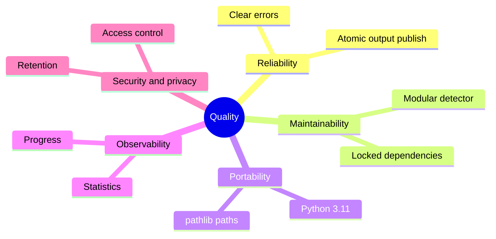

# Non-Functional Requirements

| ID | Requirement | Target/verification |
|---|---|---|
| NFR-001 | Reproducible environment | Python 3.11 and committed uv lockfile |
| NFR-002 | Maintainability | Configuration and processing are separate reusable types |
| NFR-003 | Portability | pathlib paths; no machine-specific absolute paths |
| NFR-004 | Reliability | Defined error for each initialization failure |
| NFR-005 | Output integrity | Temporary output is atomically published after success |
| NFR-006 | Observability | Progress every 100 frames plus final summary |
| NFR-007 | Privacy | Retention and access policy approved before production |
| NFR-008 | Security | Authentication, authorization, and audit in API phase |
| NFR-009 | Scalability | Queue workers for concurrent video jobs |
| NFR-010 | Performance | Baseline FPS by resolution and hardware before release |

Targets for throughput, availability, and retention must be baselined with real CCTV workloads before production launch.

## Quality attribute priorities

