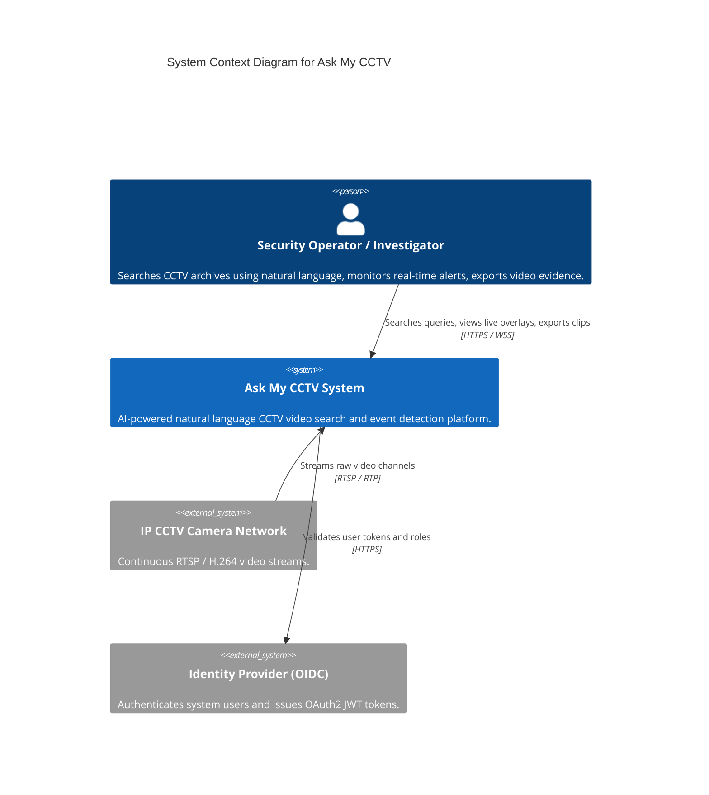
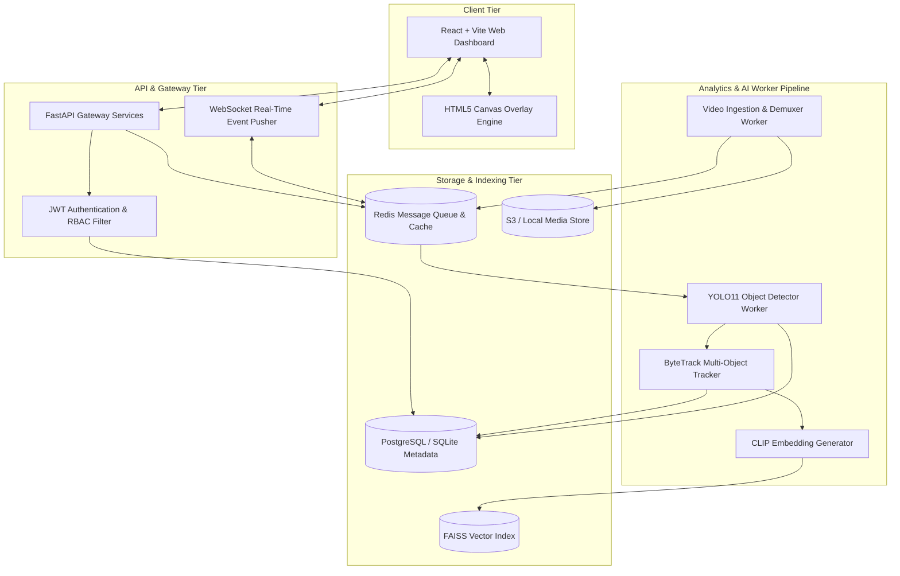
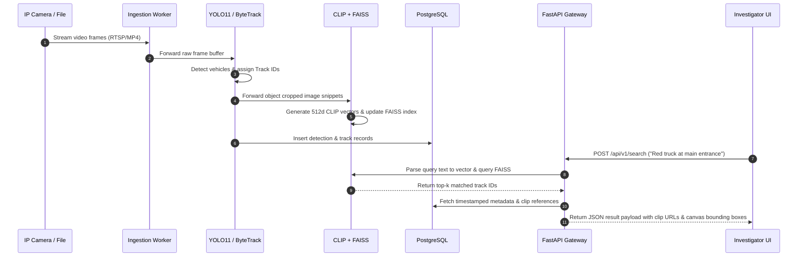

# System Architecture Document

| Field | Value |
|---|---|
| Project | Ask My CCTV |
| Document Version | 2.0.0 (Enterprise Architecture Blueprint) |
| Architecture Style | Microservices & Event-Driven Asynchronous Pipeline |
| Status | Approved Architecture |

---

## 1. Architectural Principles

1. **Separation of Media Ingestion & Analytics**: Frame demuxing and video streaming must remain strictly decoupled from deep-learning inference, tracking, and vector indexing.
2. **Immutability of Original Footage**: Source CCTV streams and video files are treated as read-only evidence. Derived artifacts (annotations, cropped object snippets, vectors) are indexed separately.
3. **Metadata-First Querying**: Search operations execute over indexed scalar metadata (SQL) and vector embeddings (FAISS) without touching raw video binaries during query processing.
4. **Fault-Tolerant Asynchronous Execution**: All heavy processing tasks execute within isolated background workers with idempotent state recovery.

---

## 2. High-Level System Context (C4 Level 1)

---

## 3. Container & Component Architecture (C4 Level 2 & 3)

---

## 4. Subsystem Component Specification

### 4.1 Ingestion & Demuxing Subsystem
* **Responsibility**: Ingests multi-format RTSP streams and static MP4 files, demuxes streams into standardized $1080\text{p}$ RGB frames, and computes hardware timestamps.
* **Technology**: OpenCV `VideoCapture`, FFmpeg C API bindings.

### 4.2 Computer Vision Engine (`backend/detection`)
* **Responsibility**: Runs object detection across frames using YOLO11, filters target classes, and computes bounding boxes.
* **Technology**: PyTorch, Ultralytics YOLO11, TensorRT execution backend.

### 4.3 Multi-Object Tracking & Event Engine (`backend/tracking`, `backend/events`)
* **Responsibility**: Connects detections across consecutive frames to form unique trajectories (`track_id`), evaluates spatial polygon crossing (ROI), and logs stationary or unauthorized movement events.
* **Technology**: ByteTrack algorithm, Shapely geometric polygon library.

### 4.4 Vector Search Engine (`backend/search`)
* **Responsibility**: Encodes object crop snippets into 512-dimensional vector embeddings, maintains FAISS Index FlatIP / HNSW, and executes natural language text query matching.
* **Technology**: OpenAI CLIP (`ViT-B/32`), FAISS C++ Python bindings.

### 4.5 API Service & Persistence Layer (`backend/api`, `backend/db`)
* **Responsibility**: Exposes OpenAPI REST endpoints, manages PostgreSQL/SQLite metadata connections, enforces security policy, and pushes live WebSocket events.
* **Technology**: FastAPI, SQLAlchemy ORM, Pydantic v2, Redis pub/sub.

---

## 5. End-to-End Data Flow (Sequence Diagram)

---

## 6. Security Boundaries & Trust Zones

| Boundary | Security Controls Implemented |
|---|---|
| **Ingestion Trust Zone** | Strict stream decoding sandboxing, RTSP authentication credentials stored in secure environment vaults. |
| **API Gateway Boundary** | HTTPS TLS 1.3 enforced, OAuth2/JWT token validation, rate-limiting ($100$ req/min). |
| **Media Storage Boundary** | Signed, short-lived evidence URLs (expiry $15$ mins), AES-256 server-side encryption at rest. |
| **Audit & Governance Zone** | Read-only append-only audit log database tables with SHA-256 verification. |
