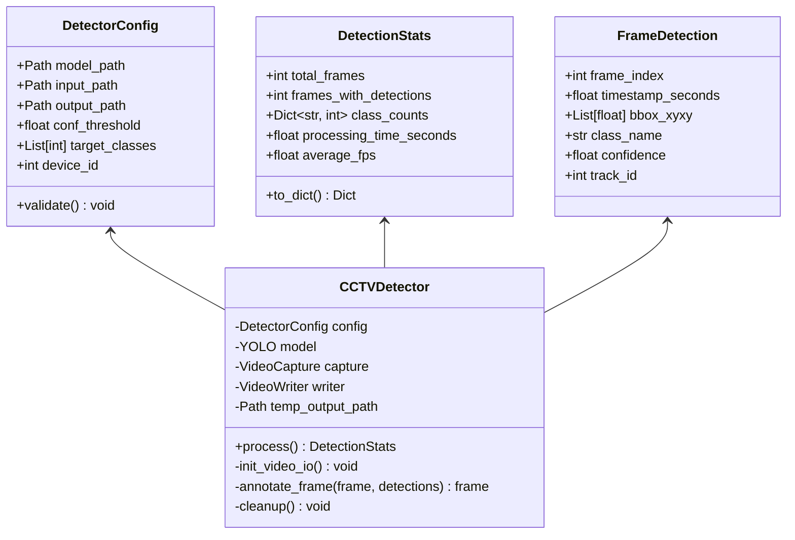
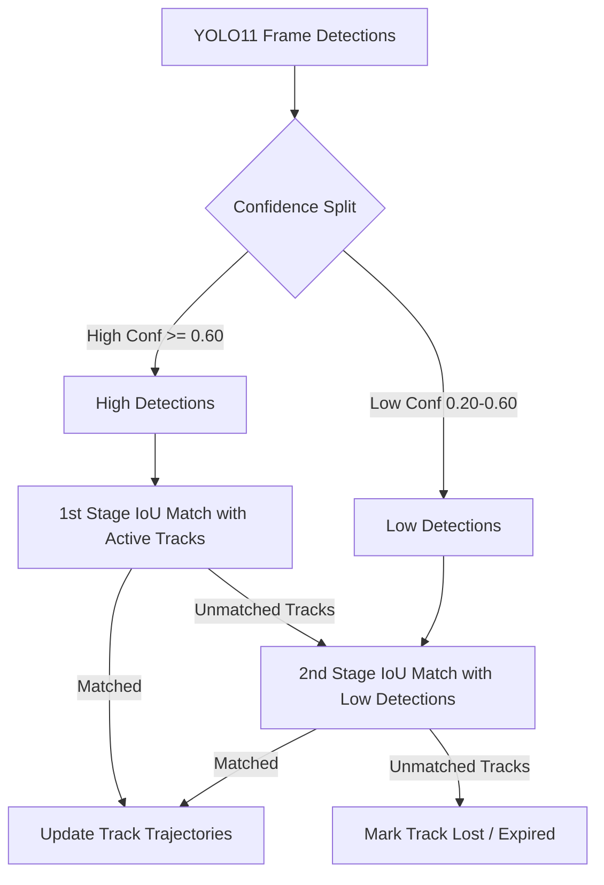

# Detailed Technical Design Document

| Field | Value |
|---|---|
| Project | Ask My CCTV |
| Document Version | 2.0.0 (Detailed Engineering Design) |
| Core Implementation | `backend/detection`, `backend/tracking`, `backend/search`, `backend/api` |
| Status | Approved Technical Design |

---

## 1. Class & Component Design (`backend/detection`)

The detection subsystem follows strict immutable configuration patterns and clean separation of concerns.



---

## 2. Core Detection & Atomic File Algorithm

### 2.1 Atomic Video Writing Lifecycle
To prevent partial, unplayable, or corrupt MP4 outputs from being exposed as valid video evidence when a run fails or is interrupted:

1. **Resolution of Repository Paths**: Input video and model paths are validated.
2. **Temporary Artifact File Allocation**: A temporary file path appended with `.part.mp4` is initialized (e.g., `output_video.part.mp4`).
3. **Capture & Writer Initialization**: OpenCV `VideoCapture` decodes input stream parameters (FPS, width, height, codec). OpenCV `VideoWriter` opens the `.part.mp4` target with matching codec parameters (`mp4v` or `avc1`).
4. **Frame Processing Loop**:
   ```python
   while capture.isOpened():
       ret, frame = capture.read()
       if not ret:
           break
       results = model.predict(frame, conf=config.conf_threshold, classes=config.target_classes)
       annotated_frame = render_boxes(frame, results)
       writer.write(annotated_frame)
   ```
5. **Atomic Publication**: Upon successful completion, capture and writer file handles are closed inside a `finally` block, and `os.replace(temp_output_path, final_output_path)` performs an atomic filesystem swap.

---

## 3. ByteTrack Integration & Trajectory Analysis

Multi-object tracking associates individual frame bounding boxes into temporal trajectory tracks $T_i = \{d_1, d_2, \dots, d_k\}$.

### 3.1 Kalman Filter & Association Logic
* **State Representation**: $[x, y, a, h, \dot{x}, \dot{y}, \dot{a}, \dot{h}]$ where $(x, y)$ is bounding box center, $a$ is aspect ratio, and $h$ is height.
* **Two-Stage Hungarian Matching**:
  1. High-confidence detections ($C \ge 0.60$) are matched with active track predictions using Intersection over Union (IoU) distance metrics.
  2. Unmatched low-confidence detections ($0.20 \le C < 0.60$) are matched against remaining unmatched tracks to preserve tracking through occlusions.



---

## 4. Polygon Region of Interest (ROI) & Event Logic

Events are triggered when a tracked object's centroid $(x_c, y_c)$ intersects a user-defined polygon zone $P_{ROI}$.

```python
from shapely.geometry import Point, Polygon

roi_polygon = Polygon([(100, 200), (500, 200), (500, 800), (100, 800)])
object_centroid = Point(det.bbox_center_x, det.bbox_center_y)

if roi_polygon.contains(object_centroid):
    trigger_event(
        event_type="ZONE_INTRUSION",
        track_id=det.track_id,
        timestamp=det.timestamp_seconds
    )
```

---

## 5. Natural Language Query Engine & CLIP Vector Integration

The search pipeline translates free-form text input into a hybrid relational-vector query.


1. **Text Query Encoding**: Prompt *"Red car"* is passed to `clip.encode_text()`, returning a normalized 512-dimensional vector $\mathbf{v}_{text} \in \mathbb{R}^{512}$.
2. **FAISS Index Lookup**: $\mathbf{v}_{text}$ executes cosine similarity search against stored frame crop embeddings $\mathbf{v}_{crop}_i$.
3. **Metadata Filtering**: SQL filters constrain the candidate set by timestamp range, camera ID, and vehicle class.
