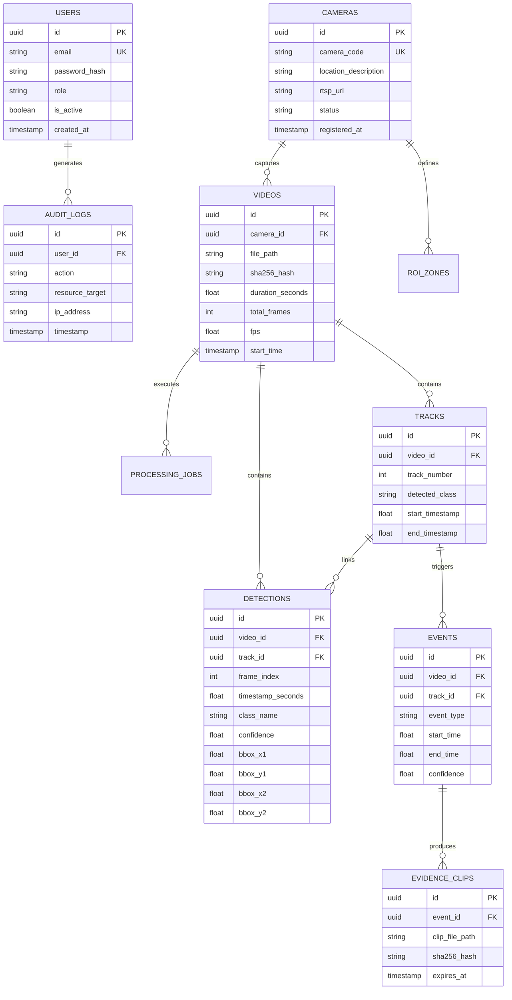

# Enterprise Database Specification

| Field | Value |
|---|---|
| Project | Ask My CCTV |
| Document Version | 2.0.0 (Production Database Schema) |
| Relational DB | PostgreSQL 15+ / SQLite 3.40+ (Phase 1 Local) |
| Vector Index | FAISS (FlatIP / HNSW Index) |
| Time Standard | UTC ISO-8601 |

---

## 1. Entity-Relationship Diagram (ERD)



---

## 2. SQL DDL Table Schemas

### 2.1 `cameras` Table
```sql
CREATE TABLE cameras (
    id UUID PRIMARY KEY DEFAULT gen_random_uuid(),
    camera_code VARCHAR(64) UNIQUE NOT NULL,
    location_description TEXT NOT NULL,
    rtsp_url TEXT NOT NULL,
    status VARCHAR(32) NOT NULL DEFAULT 'ACTIVE',
    registered_at TIMESTAMP WITH TIME ZONE DEFAULT CURRENT_TIMESTAMP
);
```

### 2.2 `videos` Table
```sql
CREATE TABLE videos (
    id UUID PRIMARY KEY DEFAULT gen_random_uuid(),
    camera_id UUID NOT NULL REFERENCES cameras(id) ON DELETE CASCADE,
    file_path TEXT NOT NULL,
    sha256_hash CHAR(64) NOT NULL,
    duration_seconds REAL NOT NULL,
    total_frames INTEGER NOT NULL,
    fps REAL NOT NULL,
    start_time TIMESTAMP WITH TIME ZONE NOT NULL,
    created_at TIMESTAMP WITH TIME ZONE DEFAULT CURRENT_TIMESTAMP
);

CREATE INDEX idx_videos_camera_time ON videos(camera_id, start_time);
```

### 2.3 `tracks` Table
```sql
CREATE TABLE tracks (
    id UUID PRIMARY KEY DEFAULT gen_random_uuid(),
    video_id UUID NOT NULL REFERENCES videos(id) ON DELETE CASCADE,
    track_number INTEGER NOT NULL,
    detected_class VARCHAR(64) NOT NULL,
    start_timestamp REAL NOT NULL,
    end_timestamp REAL NOT NULL
);

CREATE INDEX idx_tracks_video_class ON tracks(video_id, detected_class);
```

### 2.4 `detections` Table
```sql
CREATE TABLE detections (
    id UUID PRIMARY KEY DEFAULT gen_random_uuid(),
    video_id UUID NOT NULL REFERENCES videos(id) ON DELETE CASCADE,
    track_id UUID REFERENCES tracks(id) ON DELETE SET NULL,
    frame_index INTEGER NOT NULL,
    timestamp_seconds REAL NOT NULL,
    class_name VARCHAR(64) NOT NULL,
    confidence REAL NOT NULL CHECK (confidence >= 0.0 AND confidence <= 1.0),
    bbox_x1 REAL NOT NULL,
    bbox_y1 REAL NOT NULL,
    bbox_x2 REAL NOT NULL,
    bbox_y2 REAL NOT NULL
);

CREATE INDEX idx_detections_video_time ON detections(video_id, timestamp_seconds);
```

### 2.5 `audit_logs` Table
```sql
CREATE TABLE audit_logs (
    id UUID PRIMARY KEY DEFAULT gen_random_uuid(),
    user_id UUID REFERENCES users(id) ON DELETE SET NULL,
    action VARCHAR(128) NOT NULL,
    resource_target TEXT NOT NULL,
    ip_address VARCHAR(45) NOT NULL,
    timestamp TIMESTAMP WITH TIME ZONE DEFAULT CURRENT_TIMESTAMP
);

CREATE INDEX idx_audit_timestamp ON audit_logs(timestamp);
```

---

## 3. FAISS Vector Index Schema

Vector embeddings for cropped object image snippets are stored in a binary FAISS index file mapped via SQL:

| Property | Value |
|---|---|
| Vector Dimension | 512 ($d = 512$, CLIP `ViT-B/32`) |
| Distance Metric | Cosine Similarity / Inner Product (`FAISS.METRIC_INNER_PRODUCT`) |
| Index Type | `IndexFlatIP` (Exact search, $<100k$ vectors) / `IndexHNSWFlat` (Scaled ANN, $>100k$ vectors) |
| ID Mapping | Vector ID maps 1-to-1 to SQLite/PostgreSQL `detections.id` UUID |
