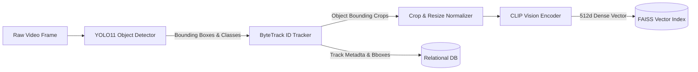
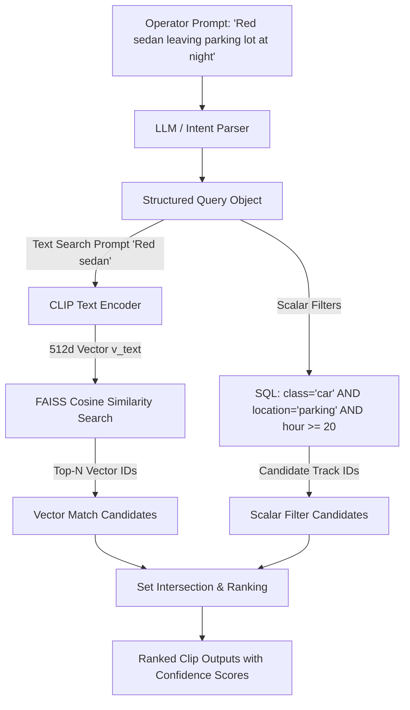

# AI/ML & Natural Language Architecture Specification

| Field | Value |
|---|---|
| Project | Ask My CCTV |
| Document Version | 2.0.0 (Production AI Blueprint) |
| Object Detection | Ultralytics YOLO11 (nano / small / custom fine-tuned) |
| Multi-Object Tracking | ByteTrack Algorithm |
| Multimodal Embedding | OpenAI CLIP (`ViT-B/32` / `ViT-L/14`) |
| Vector Engine | FAISS (`IndexFlatIP` / `IndexHNSWFlat`) |

---

## 1. Deep Learning Pipeline Overview

---

## 2. Component Detail & Model Selection

### 2.1 Object Detection Subsystem (YOLO11)
* **Model Checkpoint**: Ultralytics YOLO11 (`yolo11n.pt` for CPU/edge baseline, `yolo11x.pt` for high-accuracy GPU node).
* **COCO Class Filtering**: Road vehicle classes (`bicycle` [1], `car` [2], `motorcycle` [3], `bus` [5], `truck` [7]).
* **Anchor & Input Resolution**: Standard $640 \times 640$ pixels, batch size 1 (real-time stream) or batch size 16 (offline batch video ingestion).
* **Execution Hardware**: TensorRT optimized engine export (`.engine`) for NVIDIA CUDA targets.

### 2.2 Multi-Object Tracking (ByteTrack)
* **Association Principle**: Uses low-confidence and high-confidence detection boxes without discarding ambiguous bounding boxes.
* **Identity Preservation**: Tracks unique IDs ($1, 2, \dots, N$) across frame occlusions, camera angle switches, and momentary motion pauses.

### 2.3 Visual Embeddings (CLIP `ViT-B/32`)
* **Cropped Image Normalization**: Each detected bounding box area $[x_1, y_1, x_2, y_2]$ is cropped from the original RGB frame, resized to $224 \times 224$, and normalized using ImageNet mean/standard deviation.
* **Vector Generation**: Forward pass through CLIP Vision Transformer returns a 512-dimensional vector $\mathbf{v} \in \mathbb{R}^{512}$ satisfying $||\mathbf{v}||_2 = 1.0$.

---

## 3. Natural Language Search & Hybrid Query Architecture

When an operator inputs a natural language prompt (e.g. *"Red sedan leaving parking lot at night"*):

---

## 4. Model Evaluation Protocol & Quality Metrics

All models must pass formal benchmarks before production deployment:

| Metric | Target Value | Evaluation Method |
|---|---|---|
| **mAP@0.50 (Vehicle Detection)** | $\ge 92.5\%$ | Evaluated against 5,000 annotated CCTV video frames. |
| **IDF1 (Tracking Identification)** | $\ge 82.0\%$ | Measures persistent ID tracking accuracy over time. |
| **Top-5 Query Recall (NL Search)** | $\ge 88.0\%$ | Percentage of relevant evidence clips returned in top 5 query results. |
| **False Positives / Hour** | $< 2.0$ per camera | Evaluated over 24-hour benchmark CCTV recordings. |
