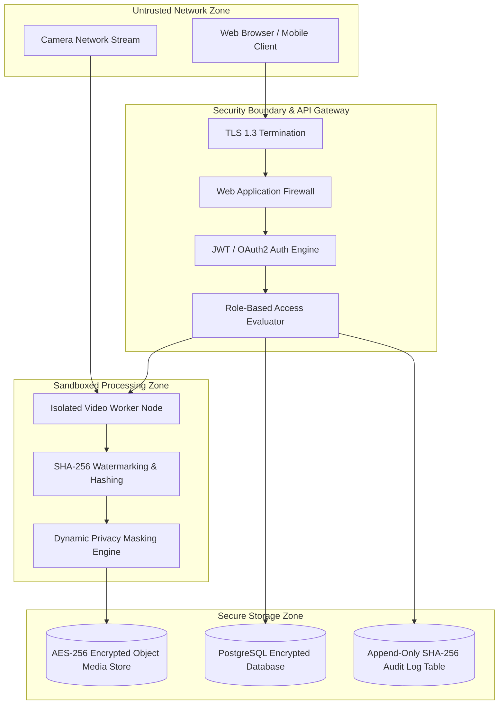

# Enterprise Security, Privacy & Evidence Compliance Specification

| Field | Value |
|---|---|
| Project | Ask My CCTV |
| Document Version | 2.0.0 (Enterprise Security Architecture) |
| Security Framework | OWASP ASVS 4.0 / GDPR Privacy Compliance |
| Classification | Sensitive Video Evidence & Operational Surveillance Data |

---

## 1. Security Architecture & Threat Model

---

## 2. Role-Based Access Control (RBAC) Matrix

| User Role | View Live Feeds | Execute Search | Export Evidence Clips | Manage Cameras | Purge Footage | Access Audit Logs |
|---|:---:|:---:|:---:|:---:|:---:|:---:|
| **Security Operator** | ✅ | ✅ | ❌ | ❌ | ❌ | ❌ |
| **Forensic Investigator**| ✅ | ✅ | ✅ | ❌ | ❌ | ❌ |
| **Security Supervisor** | ✅ | ✅ | ✅ | ✅ | ❌ | ✅ |
| **System Administrator**| ✅ | ❌ | ❌ | ✅ | ✅ | ✅ |

---

## 3. Legal Chain of Custody & Evidence Tamper-Proofing

To ensure video clips exported from Ask My CCTV are legally admissible in court:

1. **SHA-256 Digital Fingerprinting**: Immediately upon video ingestion or clip generation, the system computes an immutable cryptographic hash $H = \text{SHA256}(\text{video\_bytes})$.
2. **Metadata Binding**: $H$ is stored alongside user identity, timestamp, camera serial number, and processing config in an append-only audit database table.
3. **Signed Download Tokens**: Exported clip URLs are short-lived pre-signed tokens (valid for 15 minutes) carrying embedded cryptographic signatures.

---

## 4. Privacy & Dynamic Blurring/Masking (`GDPR / Regional Privacy Compliance`)

* **Privacy Masking**: Authorized users can define permanent privacy polygons over non-surveillance areas (e.g. neighboring private residential windows or public sidewalks).
* **Automatic Anonymization on Export**: For routine non-investigative requests, an automated pipeline applies Gaussian blur filters over human faces and license plates prior to export.

---

## 5. Encryption & Secret Management

* **Encryption in Transit**: All API, WebSocket, and stream channels enforce TLS 1.3 using strong cipher suites (`TLS_AES_256_GCM_SHA384`).
* **Encryption at Rest**: PostgreSQL databases and Object Storage buckets enforce AES-256 server-side encryption.
* **Secret Isolation**: Camera RTSP passwords, JWT signing keys, and database credentials must be fetched from environment variables or external secret vaults (HashiCorp Vault / AWS Secrets Manager).
