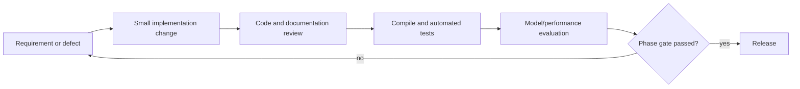

# Development Plan

## Delivery gates

Each phase has an explicit exit gate. A future phase may begin design work, but implementation and release claims require the preceding gate to pass.

## Phase 1: Detection

- Maintain Python 3.11 and uv lockfile.
- Keep input under `videos/input/` and output under `videos/processed/`.
- Run compile checks and detector smoke tests.
- Record model and confidence configuration with each result.
- Gate: output is playable, error paths are tested, and detection limitations are documented.

## Phase 2: Tracking

Add a proven tracker, stable track IDs, trajectory records, and tests for occlusion and re-entry. Gate on IDF1/identity-switch targets over a labeled sequence set.

## Phase 3: Events and indexing

Add event rules/models, metadata persistence, clip generation, and retrieval evaluation. Gate on event precision/recall and evidence timestamp accuracy.

## Phase 4: Query and dashboard

Add FastAPI, authentication, natural-language query interpretation, React dashboard, and evidence export. Gate on authorization tests, query acceptance tests, and operator review.

## Engineering workflow

Use small changes, code review, automated tests, dependency pinning, reproducible fixtures, and documented decisions. Do not start the next phase until the current phase acceptance criteria pass.

## Delivery flow

