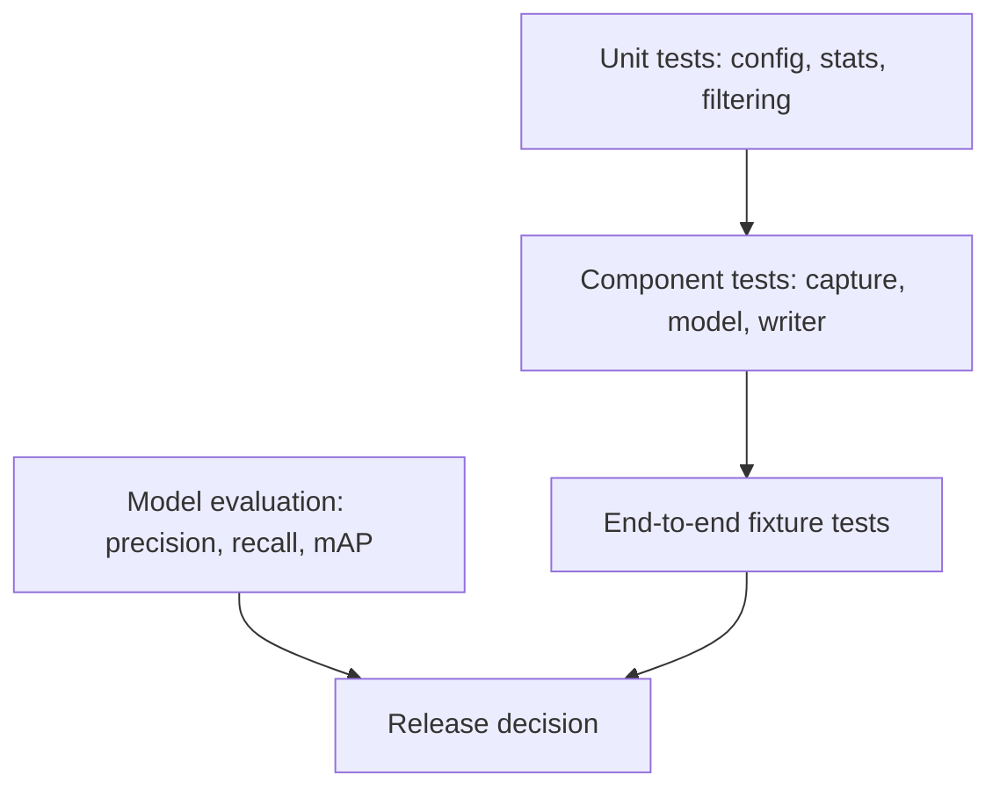

# Testing Strategy

## Test levels

- **Unit:** configuration validation, statistics, class filtering, and path behavior.
- **Component:** model loading, capture, writer, temporary-output lifecycle.
- **End-to-end:** a short fixture produces a playable annotated video and expected CLI summary.
- **Evaluation:** labeled footage measures model quality and performance.
- **Security:** future API authorization, upload validation, retention, and audit tests.

## Phase 1 tests

- Missing model produces a clear error.
- Missing input produces a clear error.
- Invalid confidence is rejected.
- Invalid video capture is rejected.
- Writer initialization failure is reported.
- A small fixture produces a playable output.
- Output frame count and dimensions match the input.
- Temporary output is not published after failure.
- Vehicle class filtering excludes non-road classes.
- A failed run does not replace an existing valid final output.

## Quality measures

For labeled validation footage, measure class precision, recall, mAP, false positives per minute, and processing FPS. Test day/night, rain, occlusion, camera shake, low resolution, and crowded scenes. Store test input checksum, model version, threshold, hardware, and result summary.

## Future integration tests

Test upload-to-job lifecycle, database persistence, search ranking, authorization, clip boundaries, audit logging, and deletion/retention jobs.

## Release evidence

Every release should link to automated test results, evaluation results, known limitations, dependency lockfile, and a rollback procedure.

## Testing pyramid

