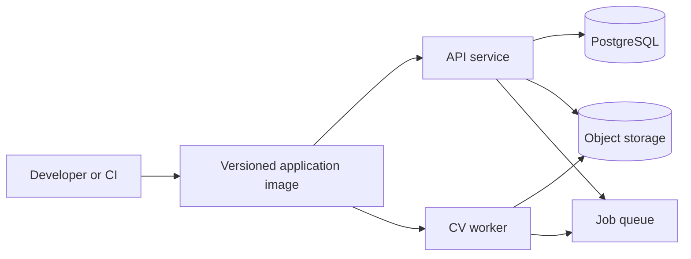

# Deployment

## Deployment status

Phase 1 is a local batch tool, not a service deployment. Production deployment is blocked until privacy, access control, retention, and evaluation requirements are approved.

## Current local deployment

From `backend/`:

```powershell
uv sync
uv run python detection\detect.py
```

The default input is `videos/input/test_cctv.mp4`; the default output is `videos/processed/test_cctv_detected.mp4`.

Use `uv sync` to reproduce the locked environment. Do not commit input footage, processed footage, secrets, or local virtual environments.

## Future deployment

Package API and workers separately. Use object storage for media, PostgreSQL for metadata, a queue for jobs, and GPU-enabled workers where throughput requires it. Keep model files versioned and verify checksums during deployment.

## Configuration

Production configuration MUST come from environment or a secret/configuration manager. Model path, storage locations, thresholds, retention, worker concurrency, and logging policy MUST be externally configurable.

## Release checklist

- Lockfile is current
- Model is present and verified
- Configuration is externalized
- Storage and retention are configured
- Health checks and logs are available
- Backup and rollback have been tested
- Privacy and access controls are approved

## Future deployment topology


