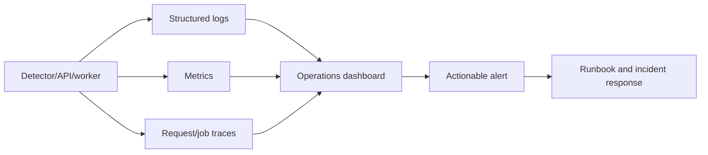

# Monitoring

## Observability standard

Every processing run should have a run ID, input checksum, model version, configuration, start/end time, status, and error code. Logs should be structured and must not contain raw frames or sensitive footage.

## Phase 1 local signals

- Frames processed
- Frames with detections
- Detection counts by class
- Processing duration and approximate FPS
- Input/output file size
- Model and confidence configuration
- Error message and failed stage
- Output integrity and final file size

## Future production metrics

- Queue depth and job latency
- Worker throughput and GPU utilization
- Detection confidence distribution
- False-positive reports
- API latency and error rate
- Search relevance feedback
- Storage utilization and retention failures
- Unauthorized access attempts

Logs must avoid leaking raw footage or sensitive personal data. Alerts should be actionable and linked to a runbook.

## Alert examples

- Worker/job failure rate exceeds the agreed threshold.
- Queue age exceeds the operator SLA.
- Output integrity checks fail.
- Storage approaches capacity or retention jobs fail.
- Unauthorized access or repeated upload validation failures increase.

## Observability flow

