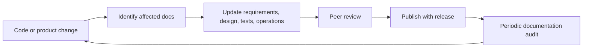

# Documentation Governance

## Document metadata

Every normative document should identify status, owner, scope, and last review date. Requirements should have stable IDs; implementation claims should name the phase in which they are supported.

## Required documentation

- Product and requirement decisions
- Architecture decision records
- Model cards and evaluation reports
- API contracts
- Deployment and rollback runbooks
- Privacy impact assessment
- Test reports and known limitations
- Incident and evidence-handling procedures

## Ownership

The project maintainer owns technical documents. Security/privacy owners approve data handling documents. Product owners approve scope and acceptance criteria.

## Change control

Update affected requirements, design, tests, and operations documents in the same change. Mark future-phase assumptions clearly. Use versioned releases and date major decisions. Review links and command examples as part of every release.

## Definition of done for documentation

- Scope and non-goals are explicit.
- Requirements are testable and traceable.
- Failure, security, privacy, and operational behavior are documented.
- Examples match the current repository.
- Future functionality is labeled as planned, not implemented.

## Documentation change flow

## Known current limitation

Phase 1 reports detections per frame. It does not report unique vehicle counts, movement, events, or natural-language search results.
