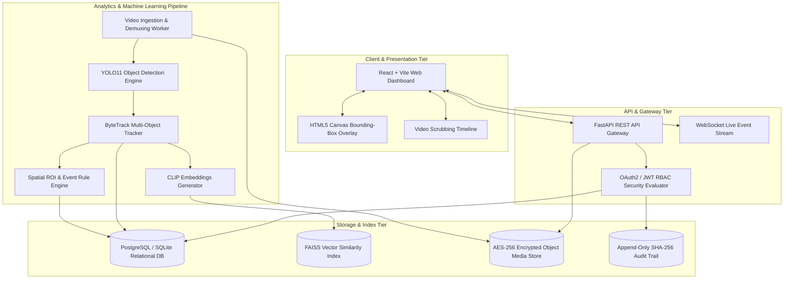

# Ask My CCTV: Consolidated Master Engineering Blueprint

| Field | Value |
|---|---|
| Project | Ask My CCTV |
| Subtitle | AI-Powered Natural Language CCTV Video Search and Event Detection System |
| Document Version | 2.0.0 (Master Engineering Blueprint) |
| Architecture Standard | Multi-Tiered Event-Driven Microservice Architecture |
| Status | Approved Master Document Baseline |

---

## 1. Executive Summary & Project Vision

**Ask My CCTV** is an enterprise-grade AI computer vision and natural language platform designed to solve the manual video scrubbing crisis in modern security surveillance infrastructure. By combining object detection (YOLO11), multi-object tracking (ByteTrack), multimodal vector embeddings (CLIP `ViT-B/32`), approximate nearest neighbor vector indexing (FAISS), and asynchronous web APIs (FastAPI & React), the system enables security operators and forensic investigators to query thousands of hours of CCTV archives using natural language prompts.

---

## 2. Master System Architecture Blueprint



---

## 3. Engineering Component Summary

### 3.1 Phase Breakdown & Scope Matrix

| Component | Phase 1 Baseline (Current) | Phase 2 (Tracking & DB) | Phase 3 (NL Search Engine) | Phase 4 (Enterprise Platform) |
|---|---|---|---|---|
| **Video I/O** | Local MP4 via OpenCV | MP4 & RTSP Streams | Multi-Camera Stream Queue | RTSP Ingestion Workers |
| **Object Detection** | YOLO11 (`yolo11n.pt`) | YOLO11 + TensorRT | Fine-tuned YOLO11 | GPU Cluster Inference |
| **Tracking** | Single frame boxes | ByteTrack Persistent IDs | Trajectory Aggregation | Cross-Camera Re-ID |
| **Search Engine** | CLI Statistics Report | SQL Class/Time Filters | CLIP + FAISS Vector Engine | Natural Language Parser |
| **User Interface** | CLI Output Annotations | CLI & Basic Controls | Query CLI Tool | React Web Dashboard |
| **Security & Persistence** | Local File System | SQLite Database | SQLite + FAISS Index | PostgreSQL + OAuth2 + Audit |

---

## 4. Key API Contracts & Data Structures

### 4.1 Search API Payload (`POST /api/v1/search`)
```json
{
  "query": "Find a red truck at the main gate between 2 PM and 5 PM",
  "camera_ids": ["cam-gate-01"],
  "start_time": "2026-08-23T14:00:00Z",
  "end_time": "2026-08-23T17:00:00Z",
  "top_k": 10
}
```

### 4.2 Search API Response (`200 OK`)
```json
{
  "total_matches": 1,
  "results": [
    {
      "video_id": "v-9981",
      "camera_code": "CAM_GATE_01",
      "timestamp": "2026-08-23T14:22:10Z",
      "frame_index": 1240,
      "confidence": 0.93,
      "bbox": [150.0, 220.0, 510.0, 680.0],
      "class_name": "truck",
      "clip_url": "/api/v1/videos/v-9981/clips/c1240.mp4"
    }
  ]
}
```

---

## 5. Verification & Compliance Checklist

* ✅ **Product Requirements Document (PRD)**: [02-prd.md](file:///c:/CS%28AI%29%20Enginering/TY/EDI_SEM_IV/ASK_my_CC_TV/docs/02-prd.md)
* ✅ **Software Requirements Specification (SRS)**: [03-srs.md](file:///c:/CS%28AI%29%20Enginering/TY/EDI_SEM_IV/ASK_my_CC_TV/docs/03-srs.md)
* ✅ **System Architecture Blueprint**: [07-system-architecture.md](file:///c:/CS%28AI%29%20Enginering/TY/EDI_SEM_IV/ASK_my_CC_TV/docs/07-system-architecture.md)
* ✅ **Detailed Technical Design**: [08-detailed-design.md](file:///c:/CS%28AI%29%20Enginering/TY/EDI_SEM_IV/ASK_my_CC_TV/docs/08-detailed-design.md)
* ✅ **Database & Vector Schema**: [09-database-design.md](file:///c:/CS%28AI%29%20Enginering/TY/EDI_SEM_IV/ASK_my_CC_TV/docs/09-database-design.md)
* ✅ **OpenAPI REST & WebSocket Spec**: [10-api-specification.md](file:///c:/CS%28AI%29%20Enginering/TY/EDI_SEM_IV/ASK_my_CC_TV/docs/10-api-specification.md)
* ✅ **AI/ML & Vector Engine Design**: [11-ai-ml-design.md](file:///c:/CS%28AI%29%20Enginering/TY/EDI_SEM_IV/ASK_my_CC_TV/docs/11-ai-ml-design.md)
* ✅ **Security & Evidence Compliance**: [12-security-privacy-design.md](file:///c:/CS%28AI%29%20Enginering/TY/EDI_SEM_IV/ASK_my_CC_TV/docs/12-security-privacy-design.md)
